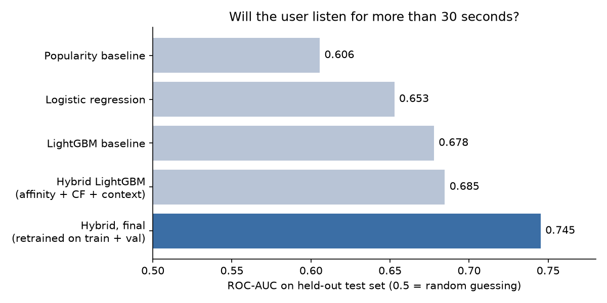

# Hybrid Music Recommender (Deezer)

Predicts whether a Deezer user will listen to a recommended song for more than 30 seconds, combining user affinity features, collaborative filtering embeddings and context in a LightGBM model trained on 7.5 million listening events.



## Problem
Deezer recommends songs to millions of users in real time, and a recommendation only works if the user actually listens. Using the DSG 2017 challenge data, we predict for each (user, song, context) event whether the song is listened to for more than 30 seconds (`is_listened`). The data is extremely sparse, imbalanced (68% positive) and strongly time-dependent, and many test users and songs never appear in the training period.

## Data
- **Source:** Deezer listening data from the DSG 2017 (Data Science Game) challenge, `train.csv` and `test.csv`. The data is not included in this repository.
- **Size after cleaning:** 7,558,184 events, 19,918 users, 452,955 songs, 67,134 artists, 2,922 genres.
- **Time range:** 2008–2016, with 98% of events in November–December 2016.
- **Cleaning:** removed 650 rows with encoding errors or invalid timestamps; imputed negative song ages with the training-set median.

## Approach
- **Chronological split:** all events sorted by time and split 80/10/10 into train, validation and test, so every model is trained on the past and evaluated on the future (no random shuffling).
- **Baselines:** popularity score, logistic regression and LightGBM on contextual and popularity features (21 features, including listening hour, song age and listen counts).
- **User affinity features:** five per-user features from the training history (genre and artist affinity, song-age compatibility, platform and time-of-day match), with global fallbacks for cold-start users.
- **Collaborative filtering:** pointwise matrix factorization in PyTorch (64-dimensional user and song embeddings plus biases, binary cross-entropy loss), with a popularity fallback for users or songs not seen in training.
- **Hybrid model:** LightGBM on contextual features, affinity features and the CF score, embeddings and a cold-start indicator.
- **Validation:** 5-fold expanding-window cross-validation in time order to compare LightGBM configurations; the final model is retrained on train + validation and evaluated once on the held-out test set.

## Results
| Model | Test AUC |
|---|---|
| Popularity baseline | 0.606 |
| Logistic regression (all features) | 0.653 |
| LightGBM baseline | 0.678 |
| Matrix factorization (all rows, with popularity fallback) | 0.582 |
| Matrix factorization (users and songs seen in training only) | 0.723 |
| Hybrid LightGBM | 0.685 |
| **Hybrid LightGBM, retrained on train + validation** | **0.745** |

- The hybrid model improves on the best baseline and, unlike matrix factorization, scores every event including cold-start users and songs (27.7% of test rows).
- Tuned LightGBM configurations performed on par with the defaults in cross-validation (mean AUC 0.719 ± 0.024 for both). Most of the final gain therefore comes from retraining on train + validation, i.e. on more recent data, not from hyperparameters.
- Ranking quality of the CF model on the test split (scorable rows, true song vs. 100 sampled negatives): HitRate@10 0.411, NDCG@10 0.229.
- The project was graded 5.6 / 6.

The AUC values come from the saved notebook outputs. The submitted course report states slightly different values for some stages (e.g. 0.748 for the final model) from a later run of the final notebook.

## My contribution
Team project with Julia Stadelmann and Semrawit Haile (HSLU, Recommender Systems module, 2026). I built the exploratory analysis (01), the preprocessing and feature engineering together with Semrawit (02), the baseline models (03), the test-set analysis (04) and the user affinity features (05). Semrawit built the collaborative filtering model (06); Julia built the hybrid model and the hyperparameter tuning (07, 08).

## How to run
The notebooks were developed in Google Colab and read their data from a Google Drive folder via `base_path`. To run them elsewhere, set `base_path` in the first cells to the folder containing the data files.

```bash
python -m venv .venv && source .venv/bin/activate
pip install -r requirements.txt
jupyter lab
```

1. Obtain the DSG 2017 Deezer dataset (`train.csv`, `test.csv`) and place it in your data folder.
2. Run the notebooks in order (01 → 08). Each notebook writes intermediate CSV files (splits, affinity features, CF features) that the next ones read.
3. Training the matrix factorization model (06) is much faster on a GPU (Colab works).

## Repository structure
```
├── notebooks/
│   ├── 01_eda.ipynb
│   ├── 02_preprocessing.ipynb
│   ├── 03_baseline_models.ipynb
│   ├── 04_test_set_analysis.ipynb
│   ├── 05_user_affinity_features.ipynb
│   ├── 06_collaborative_filtering.ipynb
│   ├── 07_hybrid_model.ipynb
│   └── 08_hyperparameter_tuning_cv.ipynb
├── docs/              # figures for this README
└── requirements.txt
```

## Limitations & next steps
- The final model is evaluated with ROC-AUC only. AUC matches the challenge metric but does not measure how well songs are ranked for each user. Next step: report ranking metrics such as NDCG@k and HitRate@k for the hybrid model, as already done for the CF model.
- The challenge target (will this user listen to this one recommendation) is narrower than the business problem: recommending to new users, long-term engagement, and feedback loops in which recommendations shape future listening behaviour.
- Cold-start remains the main weakness: more than a quarter of test events involve a user or song unseen in training.
- Package versions were not recorded in Colab; `requirements.txt` lists the libraries without exact pins.
